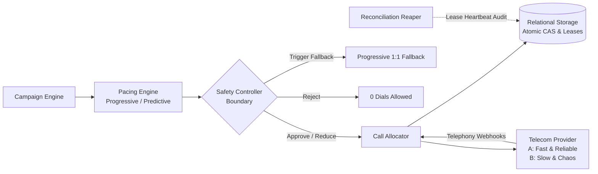

# CredResolve SmartDialer

A high-concurrency, intelligent outbound collections dialing platform featuring **Progressive Dialing**, **Predictive Pacing**, and a deterministic, non-bypassable **Safety Controller Boundary**.

---

## 1. System Architecture

The dialer strictly enforces the following pipeline:



### The Non-Bypassable Safety Boundary
The predictive pacing engine can recommend any number of calls, but it **never** directly initiates a call. The **Safety Controller** sits between the pacing logic and the telecom call allocator. It has exclusive authority to:
- **`APPROVE`**: Allow the requested call count.
- **`REDUCE`**: Cap down to safe operational and legal envelopes.
- **`REJECT`**: Block dials if the system has 0 available agents or the provider circuit breaker trips.
- **`FALLBACK_TO_PROGRESSIVE`**: Automatically lock down to strict $1:1$ progressive dialing if the rolling abandon rate exceeds $3.0\%$ or agent availability drops abruptly.

---

## 2. Explicit State Machines

### Agent Lifecycle
```
OFFLINE <───────> AVAILABLE <───────> RESERVED ───────> DIALING
                     ▲                                     │
                     │                                     ▼
                   PAUSED <─────── WRAP_UP <──────── CONNECTED
```

- **Race Condition Defense:** Two workers attempting to reserve the same agent simultaneously are resolved via **Atomic Compare-And-Swap (CAS)** on an agent version counter:
  ```sql
  UPDATE agents SET state = 'RESERVED', version = version + 1
  WHERE agent_id = ? AND state = 'AVAILABLE' AND version = ?;
  ```
  Exactly one worker gets `rowcount == 1`. The losing worker gets `rowcount == 0` and safely backs off.

### Call Lifecycle & Monotonic Protection
```
QUEUED ──> RESERVED ──> INITIATED ──> RINGING ──> ANSWERED ──> CONNECTED ──> COMPLETED
  │           │            │            │             │           │
  └───> CANCELLED <────────┴────────────┴─────────────┴───────────┴────────> FAILED
```

- **Monotonic Progression Ranks:** Terminal states (`COMPLETED`, `FAILED`, `CANCELLED`) can never be overwritten by late-arriving in-flight events (e.g. delayed `ANSWERED` or `RINGING`).
- **Idempotency:** Webhook deduplication ensures duplicate provider events (e.g., duplicate `ANSWERED`) are processed as idempotent no-ops.
- **Crash Recovery & Leases:** Worker crash during call initiation or after `ANSWERED` is detected and healed by the `ReconciliationReaper` using lease expiration timeouts.

---

## 3. Dataset Integration

The system natively ingests and leverages the provided **`collections_30k_dataset`**:
- **`accounts.csv` & `borrowers.csv`**: Prioritizes overdue debt recovery based on Days Past Due (DPD), outstanding balance, and risk segments.
- **`calls.csv`**: Calculates empirical baseline statistics:
  - Historical answer rate (~19.86% in dataset).
  - Average talk time duration (AHT).
- **`agents.csv`**: Seeds real agent rosters into the dialer.

---

## 4. Quickstart & Setup Instructions

### Prerequisites
- Python 3.10+ (tested on Python 3.13)
- Required packages (pre-installed): `pandas`, `streamlit`

### 1. Run Automated Test Suite
Executes 18 comprehensive unit, concurrency, and failure scenario tests:
```bash
python -m unittest discover tests
```
Verified test coverage:
- `test_state_machines.py`: Valid and invalid lifecycle transitions, monotonic ordering, terminal locks.
- `test_concurrency.py`: 2-worker and 10-worker simultaneous race conditions on the same agent, concurrent borrower dequeuing.
- `test_pacing.py`: Progressive 1:1 invariants, predictive Little's Law queues, decision explanation formatting.
- `test_safety_controller.py`: Overdial envelopes, compliance abandon rate tripwire, sudden agent drop detector, circuit breakers.
- `test_failure_scenarios.py`: Worker crash mid-call setup, worker crash after `ANSWERED`, duplicate webhooks, out-of-order event injection.

---

### 2. Run Comparative Benchmark Simulation
Runs Scenarios A, B, C, and D across both Progressive and Predictive modes:
```bash
python simulation.py
```
**Scenarios Simulated:**
- **Scenario A:** Answer Rate 20%, Avg Talk Time 120s (Low answer rate).
- **Scenario B:** Answer Rate 50%, Avg Talk Time 90s (Balanced collections).
- **Scenario C:** Answer Rate 70%, Avg Talk Time 180s (High answer rate).
- **Scenario D:** Dynamic Drift (changing answer rates + Provider B chaos: timeouts, duplicate events, out-of-order delivery).

**Sample Output Table:**
```
=========================================================================================================
Scenario     | Mode        | Initiated  | Connected  | Abandoned  | Aband %  | Utilization | Safety Decisions (App/Red/Rej/Fall)
---------------------------------------------------------------------------------------------------------
Scenario A   | PROGRESSIVE | 244        | 50         | 0          | 0.00%   | 11.8%      | 25 / 0 / 0 / 0
Scenario A   | PREDICTIVE  | 260        | 49         | 0          | 0.00%   | 11.5%      | 25 / 0 / 0 / 0
Scenario B   | PROGRESSIVE | 134        | 70         | 0          | 0.00%   | 16.6%      | 25 / 0 / 0 / 0
Scenario B   | PREDICTIVE  | 138        | 77         | 8          | 5.80%   | 17.7%      | 2 / 0 / 0 / 23
Scenario C   | PROGRESSIVE | 100        | 72         | 0          | 0.00%   | 15.6%      | 25 / 0 / 0 / 0
Scenario C   | PREDICTIVE  | 102        | 74         | 3          | 2.94%   | 15.3%      | 21 / 0 / 0 / 4
Scenario D   | PROGRESSIVE | 135        | 78         | 0          | 0.00%   | 11.1%      | 30 / 0 / 0 / 0
Scenario D   | PREDICTIVE  | 133        | 78         | 4          | 3.01%   | 14.1%      | 2 / 0 / 0 / 28
=========================================================================================================
```

---

### 3. Run Concurrency & High-Load Benchmark
Measures system throughput, transaction latency, and CAS contention under multi-worker pressure:
```bash
python load_test.py
```
**Sample Benchmark Results:**
- **Throughput:** ~483.1 calls/sec
- **Tick Latency (p50):** 0.43 ms
- **Contention / Double Bookings:** 0 (100% atomic CAS isolation)

---

### 4. Launch Interactive Web Dashboard
Launches the real-time Streamlit visualization dashboard:
```bash
streamlit run app.py
```
**Dashboard Features:**
- Live telemetry: Agent state distribution, active calls, rolling abandon rate.
- Interactive mode switcher: Toggle between Progressive and Predictive modes on the fly.
- Telecom Provider switcher: Switch between Provider A and Provider B (with chaos injection).
- Mathematical Pacing Audit: Inspect the exact formula inputs and human-readable explanation behind each pacing decision.
- Non-bypassable Safety Controller Log: View real-time `APPROVE`, `REDUCE`, `REJECT`, and `FALLBACK` actions.
- Interactive Chaos Injections:
  - Drop 40% of agents abruptly to trigger instant progressive fallback.
  - Trip the telecom circuit breaker to verify safe dialing halts.
  - Run the `ReconciliationReaper` to inspect orphaned lease recovery.

---

### 5. Launch FastAPI REST & Webhook Ingestion Server
Launches the OpenAPI/Swagger REST server at `http://localhost:8000/docs`:
```bash
python -m uvicorn api:app --reload --port 8000
```
- Receives inbound telephony webhooks from telecom providers (`/webhooks/telecom`, `/webhooks/plivo`).
- Exposes compliance telemetry (`/api/metrics`) and audit logs (`/api/safety/logs`).

---

### 6. Run Native SmartDialer MCP Server
Exposes Model Context Protocol (MCP) tools for AI agents (Antigravity, Claude, Cursor) to monitor and control the dialer:
```bash
python mcp_server.py
```
**Exposed Tools:**
- `get_dialer_metrics`: Live agent utilization, ringing calls, and compliance abandon rate.
- `execute_pacing_tick`: Runs progressive/predictive pacing ticks via AI tool calls.
- `inspect_safety_logs`: Inspects recent Safety Controller audit decisions and compliance justifications.
- `run_reconciliation_reaper`: Triggers lease cleanup and crashed worker recovery.
- `inject_agent_drop`: Simulates sudden agent disconnections to test compliance fallbacks.

---

### 7. Run via Docker Compose
Run both the Web Dashboard and REST API in isolated containers:
```bash
docker compose up --build
```

---

## 5. Architectural Decision Document

For comprehensive answers to all assignment questions, refer to:
👉 **[`ARCHITECTURE.md`](file:///c:/Users/shrut/Downloads/credsolver_task/ARCHITECTURE.md)**

**Topics Addressed in Depth:**
1. **Concurrency Race Walkthrough:** Exact step-by-step trace of two workers reserving the same agent at the exact same time.
2. **Database vs. Cache Discrepancies:** Authoritative single-source-of-truth resolution when cache and database disagree.
3. **Crashed Worker Recovery:** Lifecycle of an answered call when the processing worker crashes followed by a late `COMPLETED` webhook.
4. **Sudden Answer Rate Collapse:** How the Safety Controller protects compliance when answer rates plunge from 70% to 10%.
5. **Scale Bottleneck Analysis (1,000 to 100,000 Agents):** Exact database row latch contention bottlenecks and cell-based architectural fixes without saying "add more servers".
6. **Pacing Derivation:** Mathematical step-by-step breakdown of why the algorithm initiates 17 calls instead of 10.
7. **The Final Question:** Detailed design of a SmartDialer that achieves the utilization benefits of predictive dialing while retaining the deterministic safety characteristics of progressive dialing.
